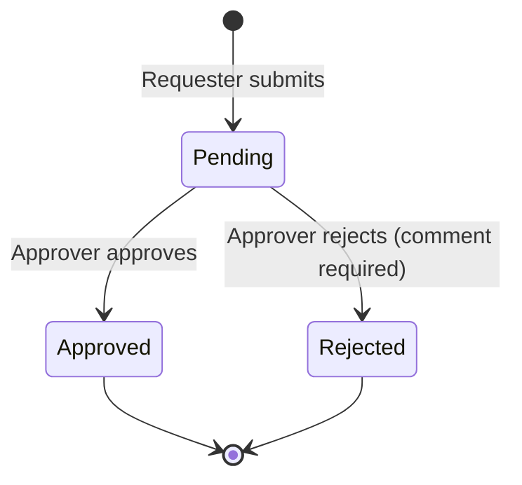

# approval-workflow-api

Approval workflow API for operational requests (overtime, procurement, manpower changes). It models
the part that usually breaks in enterprise apps: who may decide, in what order, with what audit trail,
and what happens when two approvers click at the same time.

Built from the approval workflow modules I delivered for Human Capital operations.

## State machine



Guarantees:

| Rule | Enforcement |
|---|---|
| Only a Requester submits | `X-Role` gate, `403 ROLE_FORBIDDEN` |
| Only an Approver decides | `X-Role` gate, `403 ROLE_FORBIDDEN` |
| Requester cannot decide own request | name comparison, `403 SELF_APPROVAL_FORBIDDEN` |
| A decision happens once | state check, `409 INVALID_STATE` |
| Stale clients cannot overwrite a decision | `expectedVersion`, `409 VERSION_CONFLICT` |
| Rejections always carry a reason | `400 COMMENT_REQUIRED` |
| Every transition is traceable | append-only `history` on the request |

## Endpoints

| Method | Path | Role | Purpose |
|---|---|---|---|
| GET | `/health` | anonymous | Liveness |
| POST | `/api/v1/requests` | Requester | Submit `{ title, amount }` |
| GET | `/api/v1/requests?status=pending` | any | List, newest first |
| GET | `/api/v1/requests/{id}` | any | Detail with history |
| POST | `/api/v1/requests/{id}/decisions` | Approver | `{ decision: "approve" \| "reject", comment, expectedVersion }` |

Errors use `{ errorCode, message }` with banking-style codes (`SELF_APPROVAL_FORBIDDEN`,
`VERSION_CONFLICT`, `COMMENT_REQUIRED`, …).

## Run

```bash
dotnet run --project src/ApprovalWorkflow.Api --urls http://localhost:5201

# submit
curl -s -X POST http://localhost:5201/api/v1/requests \
  -H "X-User: rina" -H "X-Role: Requester" -H "Content-Type: application/json" \
  -d '{"title":"Overtime November","amount":150000}'

# decide (use the id and version from the response)
curl -s -X POST http://localhost:5201/api/v1/requests/<id>/decisions \
  -H "X-User: budi" -H "X-Role: Approver" -H "Content-Type: application/json" \
  -d '{"decision":"approve","comment":"ok","expectedVersion":1}'
```

`src/ApprovalWorkflow.Api/ApprovalWorkflow.Api.http` contains the same calls.

## Test

```bash
dotnet test
```

12 tests: authentication gate, submission defaults, approval transition + audit entry, role gates,
self-approval block, double decision, stale version, rejection comment requirement, rejection audit,
status filtering, and unknown id handling.

## Design notes

- **`expectedVersion` instead of "last write wins"**: an approver who loaded the screen before another
  decision gets a conflict, not a silent overwrite.
- **History lives on the aggregate** and is replaced, never mutated, on each transition. That makes
  every response a complete audit snapshot.
- **Transitions are serialized** in the store, so two concurrent approvals cannot both succeed.
- **Validation happens before the state machine**, keeping error codes stable for channel teams.
- Identity headers are a demo stand-in for the gateway's JWT/OIDC claims. The rest of the code does
  not care where the authenticated name and role come from.

## Limitations (deliberate)

- In-memory store: restart loses requests. Production version persists the aggregate and appends
  audit rows in the same transaction.
- No notification/e-mail on decision; that belongs to a messaging layer.
